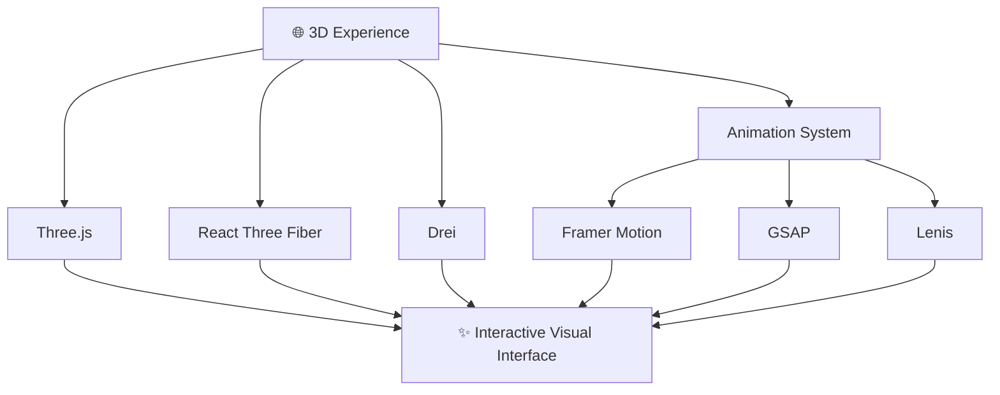
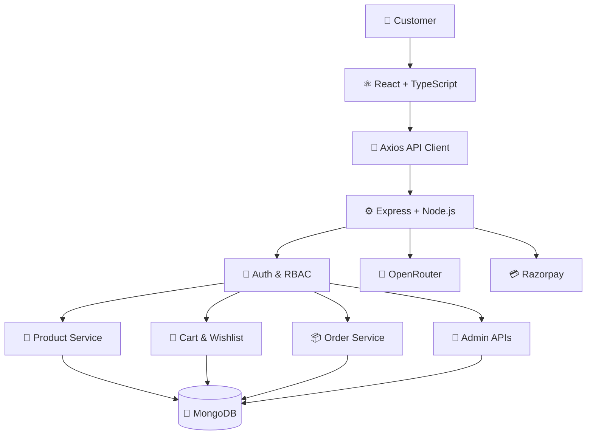
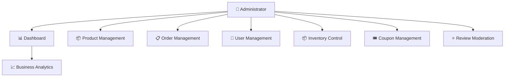
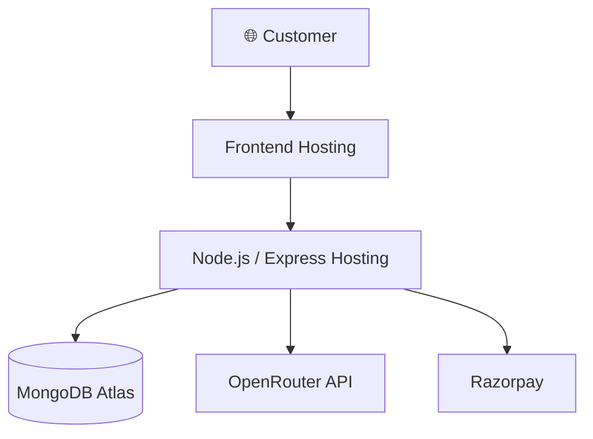

# 🥬 FreshMart — 3D Organic Grocery Marketplace

<p align="center">
  
</p>

<p align="center">
  
</p>

<p align="center">
  
  
  
  
  
</p>

<p align="center">
  
  
  
  
  
</p>

<p align="center">
  <strong>🥑 A modern full-stack grocery marketplace combining immersive 3D visuals, AI-powered product discovery, secure e-commerce, and powerful administration tools.</strong>
</p>

<p align="center">
  <a href="#-overview">Overview</a> •
  <a href="#-features">Features</a> •
  <a href="#-3d-experience">3D Experience</a> •
  <a href="#-Full-Stack Architecture">Architecture</a> •
  <a href="#-installation">Installation</a> •
  <a href="#-Roadmap">Roadmap</a>
</p>

---

## 🌱 Overview

**FreshMart** reimagines the traditional grocery shopping experience through a premium organic-inspired interface, immersive 3D elements, AI-assisted product discovery, and a complete full-stack e-commerce workflow.

The application combines a React and TypeScript frontend with a Node.js and Express backend, MongoDB persistence, authentication, shopping workflows, payment integration, and an administrative dashboard.

### 🌟 The FreshMart Experience

<table>
<tr>
<td width="33%" align="center">

### 🥬 Discover

Explore grocery products through a modern, responsive marketplace.

</td>
<td width="33%" align="center">

### 🤖 Shop Smarter

Use AI-assisted search and product recommendations.

</td>
<td width="33%" align="center">

### 🛒 Shop Securely

Manage your cart, checkout, orders, and shopping account.

</td>
</tr>
</table>

### 🧭 Application Flow

```text
                 🥬 FRESHMART
                      │
          ┌───────────┼───────────┐
          ▼           ▼           ▼
      🛍️ SHOPPING   🤖 AI      🌐 3D UX
          │        ASSISTANT       │
          ▼           ▼           ▼
       Products   Discovery    Animations
       Cart       Suggestions  Interactive UI
       Wishlist   AI Search    3D Scenes
          │           │           │
          └───────────┼───────────┘
                      ▼
                💳 CHECKOUT
                      │
                      ▼
                 📦 ORDERS
                      │
                      ▼
              📊 ADMIN CONTROL
```

---

## ✨ Features

### 🛍️ Modern Grocery Marketplace

- Product catalog with search and filtering
- Product details and featured products
- Shopping cart and quantity management
- Wishlist for saved products
- Customer reviews and ratings
- Responsive shopping interface

### 🤖 AI Shopping Assistant

FreshMart integrates OpenRouter-powered AI into the grocery discovery experience.

- Natural-language product search
- Product recommendations
- Conversational shopping assistance
- Product-aware responses
- AI-assisted product discovery

```text
             👤 CUSTOMER
                  │
                  ▼
          💬 AI SHOPPING CHAT
                  │
                  ▼
          🧠 AI PROCESSING
                  │
         ┌────────┼────────┐
         ▼        ▼        ▼
      🔎 Search 🎯 Suggest 🛍️ Discover
         │        │        │
         └────────┼────────┘
                  ▼
            🥬 PRODUCTS
```

AI output should be validated against actual product data before being used for availability, pricing, or checkout decisions.

### 🌐 Immersive 3D Experience

Built with Three.js, React Three Fiber, and Drei.

- Interactive 3D hero scenes
- Particle effects
- Immersive product-oriented visuals
- Smooth transitions and motion effects
- Responsive layouts
- Reduced-motion support

### 🛒 Complete Shopping Workflow

```text
🔎 Discover Products
        ↓
🛍️ Browse & Filter
        ↓
❤️ Save to Wishlist
        ↓
🛒 Manage Cart
        ↓
💳 Checkout
        ↓
📦 Track Orders
        ↓
⭐ Share Reviews
```

### 💳 Checkout and Payments

- Checkout workflow
- Razorpay payment integration
- Cash on Delivery support
- Order creation and management
- Payment status handling, where implemented

Actual payment processing requires valid provider credentials and server-side payment verification.

### 📊 Admin Dashboard

| Capability | Description |
|---|---|
| 📦 Products | Manage product information |
| 🏷️ Categories | Organize grocery categories |
| 📋 Orders | Review and manage orders |
| 👥 Users | Manage customer accounts |
| 📦 Inventory | Monitor product stock |
| 🎟️ Coupons | Manage promotional discounts |
| ⭐ Reviews | Moderate customer reviews |
| 📈 Analytics | View business activity and metrics |

### 🔐 Security

- JWT authentication
- Refresh-token rotation flow
- HTTP-only cookie support
- bcrypt password hashing
- Role-based access control
- Zod request validation
- Helmet security headers
- CORS allowlist
- API rate limiting

### ♿ Accessibility

- Semantic HTML
- Keyboard navigation
- Visible focus indicators
- ARIA labels and roles
- WCAG AA-oriented color contrast
- Screen-reader compatibility
- `prefers-reduced-motion` support

---

## 🎬 Animated Showcase

<p align="center">
  
</p>

<table>
<tr>
<td width="50%" align="center">

### 🥬 Product Discovery

Explore an organic-inspired grocery marketplace.

</td>
<td width="50%" align="center">

### 🌐 3D Interface

Experience immersive visuals and motion design.

</td>
</tr>
<tr>
<td width="50%" align="center">

### 🤖 AI Shopping

Discover products through conversational assistance.

</td>
<td width="50%" align="center">

### 📊 Admin Command Center

Manage products, orders, inventory, and reviews.

</td>
</tr>
</table>

> For the strongest portfolio presentation, add screenshots or a short GIF captured from your actual running application.

---

## 🌐 3D Experience

FreshMart uses a combination of 3D rendering and motion libraries to make the interface more engaging.



### Motion and Visual Design

- **Three.js:** 3D rendering foundation
- **React Three Fiber:** React-based 3D scene composition
- **Drei:** Supporting utilities for React Three Fiber
- **Framer Motion:** Component transitions and UI animation
- **GSAP:** Timeline-based animation
- **Lenis:** Smooth scrolling
- **Tailwind CSS:** Responsive styling and design consistency

The goal is to create an engaging interface while maintaining usable navigation, accessibility, and responsive performance.

---

## 🏗️ Full-Stack Architecture



### Architecture Layers

| Layer | Responsibility |
|---|---|
| Frontend | Shopping UI, product discovery, 3D scenes, and dashboard |
| API client | HTTP communication with backend endpoints |
| Express server | Routing and application business logic |
| Authentication | Identity validation and protected access |
| Marketplace services | Products, cart, wishlist, and orders |
| AI integration | Product search and shopping assistance |
| Payment integration | Payment-provider communication |
| MongoDB | Persistent application data |

---

## 🔐 Security Architecture

```text
                🌐 CLIENT REQUEST
                       │
                       ▼
                🛡️ CORS POLICY
                       │
                       ▼
                🪖 HELMET HEADERS
                       │
                       ▼
                🚦 RATE LIMITING
                       │
                       ▼
                📝 ZOD VALIDATION
                       │
                       ▼
                🔑 JWT VALIDATION
                       │
                       ▼
                👑 RBAC CHECK
                       │
                       ▼
                🎯 CONTROLLER
                       │
                       ▼
                  🍃 MONGODB
```

### Security Practices

- Keep secrets and API keys on the server.
- Validate all incoming data.
- Enforce permissions on protected backend routes.
- Use secure password hashing.
- Configure cookie flags appropriately for production.
- Verify payment status on the server.
- Avoid trusting client-submitted prices or order totals.
- Configure CORS for trusted origins.
- Protect authentication and payment endpoints with appropriate rate limits.

---

## 👑 Admin Command Center



The administration experience brings core marketplace operations into one place, subject to the permissions implemented in the backend.

---

## 🧠 State Management and Forms

FreshMart uses lightweight state management and structured form validation.

```text
                  🧠 ZUSTAND
                      │
          ┌───────────┼───────────┐
          ▼           ▼           ▼
       👤 Auth      🛒 Cart    ❤️ Wishlist
          │           │           │
          ▼           ▼           ▼
      User State  Cart State  Saved Products
```

- **Zustand:** Global application state
- **React Hook Form:** Form state and submission
- **Zod:** Data validation
- **Axios:** API communication
- **React Router:** Application navigation
- **Recharts:** Analytics visualizations

---

## 🧰 Technology Stack

### Frontend

<p align="center">
  
</p>

- React 18
- TypeScript
- Vite
- React Router
- Tailwind CSS
- Three.js
- React Three Fiber
- Drei
- Framer Motion
- GSAP
- Lenis
- Zustand
- React Hook Form
- Zod
- Axios
- Lucide React
- Recharts

### Backend

<p align="center">
  
</p>

- Node.js
- Express.js
- TypeScript
- MongoDB
- Mongoose
- JWT
- bcryptjs
- Helmet
- CORS
- Rate limiting
- Zod
- OpenRouter
- Nodemailer

### External Integrations

<p align="center">
  
  
  
</p>

---

## 🔌 API Highlights

The documented API groups include the following routes.

### 🔐 Authentication

```http
POST   /api/auth/register
POST   /api/auth/login
POST   /api/auth/logout
POST   /api/auth/refresh
GET    /api/auth/me
```

### 🥬 Products

```http
GET    /api/products
GET    /api/products/:id
GET    /api/products/featured
GET    /api/products/bestsellers
```

### 🛒 Cart

```http
GET    /api/cart
POST   /api/cart/items
PUT    /api/cart/items/:itemId
DELETE /api/cart/items/:itemId
DELETE /api/cart
```

### 🤖 AI Shopping

```http
POST   /api/ai/chat
POST   /api/ai/recommendations
POST   /api/ai/product-search
```

### 👑 Administration

```http
GET    /api/admin/dashboard
GET    /api/admin/analytics
GET    /api/admin/orders
GET    /api/admin/users
GET    /api/admin/inventory
GET    /api/admin/coupons
GET    /api/admin/reviews
```

These routes are based on the project's documented API groups. Refer to the backend route definitions for request parameters, authorization requirements, and response schemas.

---

## 🎨 Design System

FreshMart follows a premium, dark organic visual identity.

| Design Element | Value |
|---|---|
| 🌑 Background | `#0a0f0d` |
| 🟢 Primary | `#00d46a` |
| 🌱 Secondary | `#00f5a0` |
| 🔤 Typography | Inter + Plus Jakarta Sans |
| 🌐 Visual style | Dark, premium, organic |
| ✨ Motion | Smooth and interactive |
| 📱 Layout | Responsive |

---

## 📱 Responsive by Design

```text
📱 360px Mobile
      ↓
📱 390px Mobile
      ↓
📱 430px Mobile
      ↓
📱 768px Tablet
      ↓
💻 1024px Laptop
      ↓
🖥️ 1280px Desktop
      ↓
🖥️ 1440px+ Large Displays
```

The project is designed for mobile, tablet, laptop, and large-screen browsing. Test 3D scenes on lower-powered devices and provide reduced-motion alternatives where appropriate.

---

## ♿ Accessibility

FreshMart's documented accessibility goals include:

- Semantic HTML
- Keyboard navigation
- Focus indicators
- ARIA labels and roles
- WCAG AA-oriented color contrast
- Screen-reader compatibility
- Reduced-motion support

---

## 📂 Project Structure

The project is organized into separate client and server applications.

```text
freshmart/
│
├── client/
│   └── src/
│       ├── components/
│       ├── pages/
│       ├── layouts/
│       ├── hooks/
│       ├── services/
│       ├── store/
│       ├── types/
│       ├── utils/
│       ├── animations/
│       ├── three/
│       └── styles/
│
├── server/
│   └── src/
│       ├── config/
│       ├── controllers/
│       ├── middleware/
│       ├── models/
│       ├── routes/
│       ├── services/
│       ├── utils/
│       ├── validators/
│       └── seed/
│
└── README.md
```

---

## 💻 Installation

### Prerequisites

- Node.js 20+
- npm
- MongoDB or MongoDB Atlas
- Git

### 1. Clone the Repository

```bash
git clone YOUR_EXISTING_REPOSITORY_URL
cd freshmart
```

Replace the placeholder with your existing repository URL.

### 2. Install Frontend Dependencies

```bash
cd client
npm install
```

### 3. Configure Frontend Environment

Create the environment file expected by your Vite configuration. For example:

```env
VITE_API_URL=http://localhost:5000/api
```

Use the exact variable name and API prefix configured in your project.

### 4. Start the Frontend

```bash
npm run dev
```

### 5. Install Backend Dependencies

Open another terminal:

```bash
cd server
npm install
```

### 6. Configure Backend Environment

Create a `.env` file based on the variables required by your server.

Example:

```env
NODE_ENV=development
PORT=5000
MONGODB_URI=your_mongodb_connection_string
JWT_SECRET=your_secure_random_secret
OPENROUTER_API_KEY=your_openrouter_api_key
```

Add Razorpay and email credentials only if the corresponding integrations are configured. Use the actual environment variable names from your code. **Never commit `.env` files or API secrets.**

### 7. Start the Backend

```bash
npm run dev
```

Check the `package.json` scripts in both applications if your development commands differ.

---

## 🧪 Testing and Quality

Recommended verification areas include:

- Registration, login, logout, and token refresh
- Role-based access control
- Product search and filtering
- Cart quantity and price calculations
- Wishlist operations
- Order creation and status management
- Server-side payment verification
- AI response validation
- Admin-only routes
- Responsive layout and accessibility
- Production build and environment configuration

Run the lint, test, and build commands configured in your repository.

---

## 📸 Screenshots and Demo


### 🏠 Homepage

<p align="center">
  
</p>

### 🛍️ Marketplace

<p align="center">
  
</p>

### 🤖 AI Assistant

<p align="center">
  
</p>

### 👑 Admin Dashboard

<p align="center">
  
</p>

---

## ☁️ Deployment



### Frontend Hosting

- Vercel
- Netlify

### Backend Hosting

- Render
- Railway
- Fly.io
- VPS with Nginx

### Deployment Checklist

- Configure production environment variables.
- Use MongoDB Atlas or another supported production database.
- Set trusted frontend origins in CORS.
- Configure HTTPS and secure cookies.
- Keep AI, payment, and email secrets server-side.
- Verify payment status on the backend.
- Test authentication and authorization after deployment.
- Review logs, errors, and production build output.

---

## 🗺️ Roadmap

```text
✅ Core E-Commerce
       ↓
✅ AI Shopping Assistant
       ↓
✅ 3D Shopping Experience
       ↓
🔮 AI Meal Planner
       ↓
🔮 Personalized Grocery Lists
       ↓
🔮 Voice Shopping Assistant
       ↓
🔮 PWA / Mobile App
       ↓
🔮 Advanced Recommendations
```

### Future Enhancements

- [ ] Voice-based product search
- [ ] AI-powered meal planning
- [ ] Personalized grocery lists
- [ ] Progressive Web App support
- [ ] Advanced recommendation engine
- [ ] Real-time order notifications
- [ ] Personalized offers
- [ ] Further performance optimizations for 3D scenes

---

## 🧠 What This Project Demonstrates

| Area | Skills Demonstrated |
|---|---|
| ⚛️ Frontend | React, TypeScript, responsive interfaces |
| 🌐 3D Web | Three.js, React Three Fiber, Drei |
| ✨ Animation | GSAP, Framer Motion, Lenis |
| ⚙️ Backend | Node.js, Express, REST APIs |
| 🗄️ Database | MongoDB, Mongoose |
| 🔐 Security | JWT, refresh tokens, RBAC, validation |
| 🤖 AI | LLM integration and product discovery |
| 💳 Payments | Razorpay integration workflow |
| 📊 Analytics | Recharts and admin dashboards |
| ♿ Accessibility | Keyboard support and reduced motion |
| ☁️ Deployment | Environment configuration and hosting |

---

## 🌟 Project Vision

> **Make grocery shopping feel less like a transaction and more like an experience.**

FreshMart combines immersive 3D visuals, AI-assisted discovery, full-stack e-commerce workflows, and administration tools in a single grocery marketplace.

## 👨‍💻 Developer

**Dhanush Gopi Kavala**

Full-Stack Developer | Software Engineering Graduate

<p align="center">
  <a href="https://github.com/dhanushgopi2456">
    
  </a>
  <a href="https://www.linkedin.com/in/dhanush-gopi-kavala-a460a528b/">
    
  </a>
</p>

---

<p align="center">
  
</p>

<p align="center">
  <strong>🥬 FreshMart</strong><br/>
  <em>Fresh groceries. Smarter shopping. Better experience.</em><br/><br/>
  Built with ❤️ using React • TypeScript • Node.js • MongoDB • Three.js • AI
</p>

<p align="center">
  ⭐ If you like FreshMart, consider starring the repository
</p>
